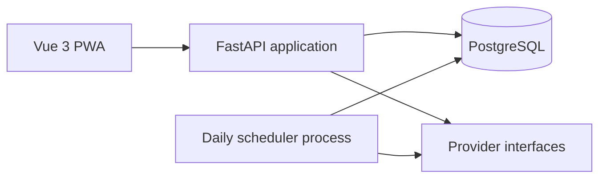

# Architecture

## Bootstrap scope

This commit contains repository configuration and a PostgreSQL development
service only. It intentionally has no application code or application
containers. CI validates repository hygiene and the Compose configuration;
application tests and image builds belong to the stages that introduce those
applications.

## Planned component overview

The browser will use the API for guest trip calculations and, in a later stage,
authenticated garage and refueling features. Provider implementations will be
behind interfaces so permitted data sources and routing engines can be
replaced independently. Scheduled data collection will be separate from
interactive requests and will persist source runs and observations.

## Planned database

The initial schema will be designed alongside the backend and migrations. The
planned entities include users, vehicles, data sources and source runs, fuel
price observations, trips and waypoints, trip expenses, and later refuelings
and fuel stations. Monetary and volume values will use exact decimal database
types; timestamps will be stored in UTC.

## Decision records

### PWA rather than browser extension

The project targets phone and desktop use through a browser, with installability
and access to previously opened calculations. A PWA provides that distribution
model without requiring a browser-specific extension.

### Providers behind interfaces

External source terms, availability, and response formats can change. Separate
provider interfaces isolate those changes from trip calculations and make
offline parser tests possible.

### Scheduled price collection rather than per-calculation fetches

Fuel prices need freshness metadata and resilience to source outages. Scheduled
collection allows validation, caching, run logging, and use of the last known
good value without making every calculation depend on an external request.

## Limitations and risks

- Swiss station-level prices are not assumed to be available through an
  official open API; the planned Swiss source provides average prices.
- TCS data access and reuse terms must be verified before implementation.
- HTML layout changes can break a permitted scraper; parsing needs fixtures,
  validation, and stale-data handling.
- Source datasets may differ in freshness, coverage, and licensing; attribution
  and discrepancies must be visible to users.
- Public map and geocoding services have usage policies and rate limits that
  must be respected.
