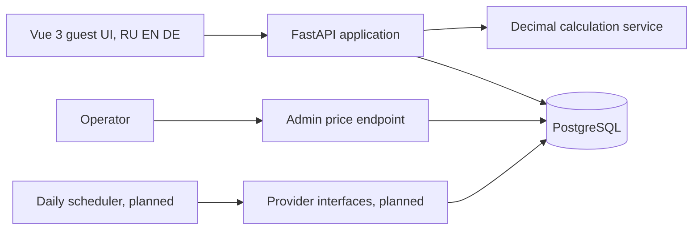
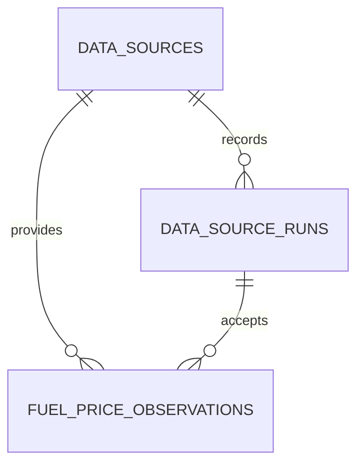

# Architecture

## Bootstrap scope

The current stage adds a FastAPI backend, calculation domain service, manual
fuel-price entry, Alembic migrations, PostgreSQL storage, and backend tests.
The frontend, user accounts, and external providers remain out of scope.

## Planned component overview

The guest interface collects trip inputs and calls the stateless calculation
endpoint. User-facing text is translated in locale message catalogs for
Russian, English, and German. Language preference is initialized from the
browser and persisted in local storage. Exact decimal inputs stay as strings
until validated and are calculated by the backend. Manual price observations
are stored in PostgreSQL with an associated source-run audit record. The write
endpoint is disabled unless an administrator key is configured. Provider
implementations will be behind interfaces so permitted data sources and
routing engines can be replaced independently.

## Planned database

The initial migration creates:

`fuel_price_observations` stores a CHF price, fuel type, `valid_since`,
`fetched_at`, and optional operator note. `data_source_runs` stores status,
timestamps, record counts, and an error detail. Indices support finding runs
per source and the latest observation per fuel type. Later migrations will add
users, vehicles, trips, waypoints, expenses, refuelings, and stations.

## Decision records

### PWA rather than browser extension

The project targets phone and desktop use through a browser, with installability
and access to previously opened calculations. A PWA provides that distribution
model without requiring a browser-specific extension.

### Providers behind interfaces

External source terms, availability, and response formats can change. Separate
provider interfaces isolate those changes from trip calculations and make
offline parser tests possible.

### Scheduled price collection rather than per-calculation fetches

Fuel prices need freshness metadata and resilience to source outages. Scheduled
collection allows validation, caching, run logging, and use of the last known
good value without making every calculation depend on an external request.

## Limitations and risks

- Swiss station-level prices are not assumed to be available through an
  official open API; the planned Swiss source provides average prices.
- TCS data access and reuse terms must be verified before implementation.
- HTML layout changes can break a permitted scraper; parsing needs fixtures,
  validation, and stale-data handling.
- Source datasets may differ in freshness, coverage, and licensing; attribution
  and discrepancies must be visible to users.
- Public map and geocoding services have usage policies and rate limits that
  must be respected.
- The manual administrator endpoint is protected by a shared environment
  secret; it is intended as a controlled fallback, not user authentication.
- The current calculation API takes a manually supplied price and does not yet
  select a stored price automatically.
- Route distance is entered manually; origin/destination fields only create
  external map links. Geocoding and route calculation are not implemented yet.
- The guest UI does not persist a calculation or share it by permanent link.
